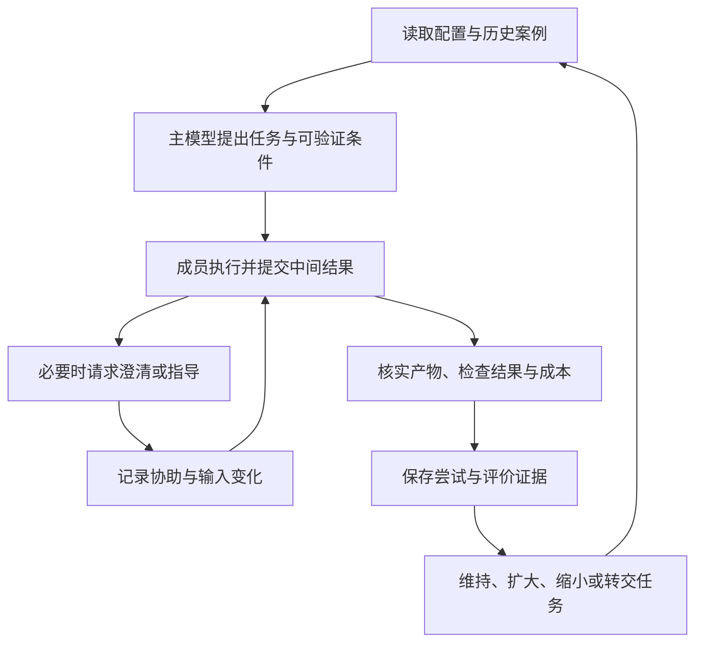

# 通过 Agent Team 协作校准模型的任务范围

日期：2026-11-06。状态：补充设计提案，尚未实现，也未完成真实模型效果验证。

本文补充[项目调研与实施计划](research-plan.md)，讨论如何让较强模型通过实际委派、交流和验收，逐步判断较弱模型适合承担哪些任务、能够独立处理多大范围，以及需要多少指导。

## 1. 目标与可行性判断

**可以在 Agent Team 中实现基于实际表现的任务分配校准。** 主模型为成员生成职责与任务，观察其产出和交互，再调整下一次委派的类型、规模和指导方式。

希望得到的结论类似：

> 在提供相关接口、限制修改范围并给出可执行验收条件时，这个配置的成员能独立完成部分局部修改。遇到未说明的跨模块约束时，通常需要额外指导；该条件下的独立完成能力仍缺少证据。

这种结论包含适用条件、证据与未验证范围。它不承诺找出模型准确、永久的能力上限，也不因为换了角色名称就认为模型获得了相应能力。

“强”和“弱”是相对于当前工作和候选配置的称呼，不是永久排序。一个总体较弱的模型可能更适合特定任务；更便宜的单次调用也可能因指导和返工增加总成本。配置选择应以实际结果为依据。

这里的学习发生在外部案例记录、任务描述和分配策略中，初期不涉及更新模型权重。主模型可以读取记录推理，插件负责保留可核实事实。

## 2. 校准对象：模型配置、任务条件与协助程度

### 2.1 对具体执行配置积累经验

能力记录至少关联以下条件：

| 条件 | 需要记录的内容 | 原因 |
|---|---|---|
| 实际模型 | provider、model、可获得的版本、观测时间 | 同名服务可能更新；无法取得版本时明确标记 |
| 推理配置 | 推理强度、采样及输出限制等实际生效参数 | 配置变化可能改变结果和成本 |
| 成员规格 | MemberSpec 版本、有效指令、基础 Agent | 同一模型接受不同职责和指令时表现会变化 |
| 执行环境 | 可用工具、权限、相关环境版本 | 工具缺失和权限拒绝不能直接归为推理失败 |
| 上下文策略 | 提供的材料范围、选择方式、压缩与历史复用 | 效果依赖成员实际看到了什么 |
| 协作配置 | 指导者、验收者及其配置引用 | 不同指导和验收方式影响最终成功率 |

同一模型不同配置分别积累案例，必要时做有说明的迁移。更换模型版本、提示策略、工具或关键上下文策略后，旧案例可作为参考，不能无条件沿用原来的信心。

长期成员还可能通过历史消息积累任务背景。记录结果时说明它使用了复用 Session 还是新上下文，避免把充分预热后的表现外推到新成员。

### 2.2 任务类型自由归纳，规模采用多维描述

专业任务名称和分类标签可以由主模型从案例中归纳，例如“根据明确规则补充边界测试”“在给定文档中核对结论”。这些标签用于描述和检索，不作为权限、任务认领资格或固定工作流程的枚举。

任务规模至少考虑：

- 需要阅读的上下文量，以及有效信息是否已被筛选。
- 涉及的模块、文件、外部资料和依赖关系范围。
- 需求是否明确，是否需要自行发现隐含约束。
- 推理步骤之间的依赖，以及探索空间大小。
- 工具操作和修改范围。
- 验收条件是否可执行，验证与返工成本有多高。

文件数、代码行数、token 数可作为特征，不能单独决定难度。一个跨边界的短修改可能比大段机械转换更难；只读调查也可能需要复杂推理。

开始前保存任务条件的估计；结束后补充实际观察。后者不能反过来冒充分配时已知的信息。

### 2.3 独立完成与指导后完成分别评价

独立完成始终相对于给定输入包定义。开始前若主模型已经提供了关键算法、修改位置或详细操作步骤，应记为前置协助；即使执行中没有再发消息，也不能据此推断成员能独立完成原始需求。

执行中的协助记录其内容和作用：

| 协助情况 | 应如何解释 |
|---|---|
| 补充缺失的接口说明或用户约束 | 说明原任务输入不完整；补充后的条件下重新判断 |
| 指出具体失败位置，要求成员自行修正 | 体现接受反馈后的修复能力，不算首次独立通过 |
| 给出关键思路、分解方案或代码草稿 | 属于实质指导，计入指导成本 |
| 主模型直接修改产物并完成工作 | 记录接管和最终产物归属，保留原尝试结果 |
| 成员主动报告不确定性或请求帮助 | 可以是良好的协作行为，不应一概视为能力失败 |

消息数量只是一项观察。一次直接给出答案的消息，可能比多次澄清投入更多实质帮助；协助含义由主模型解释，并保留对应消息和工具调用作为依据。

## 3. 一次完整的协作校准过程



1. **先选择有验证手段的工作项。** 主模型给出任务范围、可用上下文、验收要求和执行限制；可以选择直接自己执行，不必为收集样本强行委派。
2. **保存分配时的预期。** 记录为什么选择这个成员、引用哪些历史案例、哪些条件尚不确定。初期用自然语言说明，不强行生成精确成功概率。
3. **通过普通 Team 机制执行。** 成员认领任务、接收消息、提出问题和提交产物；校准层复用现有任务与通信记录。
4. **显式记录变化。** 输入补充、方案提示、预算变化、验收条件调整和主模型接管都有独立记录。改变任务范围时固定新的任务版本或另建工作项，并保留原尝试的边界。
5. **独立核实完成证据。** 检查产物和实际执行结果，再记录本次属于何种条件下的完成、失败或未决状态。
6. **更新下一次建议。** 相近条件下积累可靠案例后，才尝试扩大范围或减少指导；重大失败后先检查原因，再决定补充条件、拆小任务或接管。

初始探索优先使用边界清楚、验证方便且返工成本可控的工作。探索本身消耗预算，应有明确上限；不要为了寻找能力上限持续尝试越来越大的任务。

单次尝试尽量只明显改变一个因素，例如扩大修改范围，或减少预先给定的步骤。若多个因素同时改变，应降低对失败原因的确定程度。

## 4. 完成证据与失败归因

### 4.1 根据可观察事实评价

验证可以来自测试命令与结果、可复核的源文件引用、结构化产物检查、明确的业务断言以及人工或其他模型的复核。

需要同时记录验证器版本、检查范围和所验证的产物版本。测试通过只证明检查覆盖的条件；模型的审查意见也需要引用依据。成员自报“完成”、主模型表示满意和原生 Session 执行成功，都不足以单独确认任务质量。

成员在修改实现的同时修改了测试时，应记录哪些验收条件发生变化。不能把放宽测试后的通过等同于满足原始要求。主模型后续修复了产物，也不能覆盖成员初次提交时的失败记录。

### 4.2 允许未知和多种原因

以下是可能的分析方向，不是互斥的任务类型枚举：

| 观察 | 优先核实的问题 |
|---|---|
| 漏掉跨模块约束 | 约束是否已提供、是否能从给定材料发现、是否需要更多上下文 |
| 工具没有执行成功 | 权限、环境、工具接口、输入是否正确 |
| 超时或预算耗尽 | 实际任务范围、过程是否低效、限制是否合理 |
| 多次根据反馈仍无法修复 | 是否存在推理或执行能力限制，验证反馈是否足够具体 |
| 产物看似合理但无法验证 | 验收方法是否缺失，是否应保留未决结论 |

记录观察事实与归因假设两部分。缺少证据时使用 unknown，不自动给模型记一次能力失败，也不将该案例从总成本和未决统计中删掉。

中断、取消、接管和失败尝试同样保留。重新委派是新的尝试，不能通过反复重试只留下最后一次成功。

## 5. 建议的数据记录

以下为计划中的业务模型，尚不是已实现 API。标识符应复用 Team 的稳定身份，原始任务内容和过程记录保存在对应项目的授权范围内。

| 记录 | 核心内容 | 与已有模型的关系 |
|---|---|---|
| ExecutionConfig | 实际模型及配置、MemberSpec 版本、工具与权限、上下文策略 | 引用成员配置快照，不保存凭证 |
| TaskAttempt | attemptId、taskId、taskRevision、memberId、配置引用、分配前任务特征、开始与结束边界、产物引用 | 同一 Task 可有多次尝试，各自保留 |
| AssistanceEvent | attemptId、来源与目标、前置或执行中协助、消息或调用引用、内容摘要、影响说明 | 复用来源关联；自动记录事实，模型解释其作用 |
| Assessment | attemptId、评估者、被评产物、验证器与结果、协助情况、失败假设、未知项 | 与任务状态分开，可追加复核和修正 |
| CapabilitySummary | 适用条件、独立与受指导表现、支持与反例、配置范围、观测时间、未验证区域 | 从案例派生，可重建；不替代原始事实 |

开始尝试时保存任务、上下文和验收版本；结束时保存实际产物与检查结果的引用。必要时使用内容摘要校验引用一致性，避免后续文件修改改变“当时验证了什么”。

已有任务 `complete` 仍表示授权者提交完成声明。能力评价另行记录，不改变任务板的身份、权限和状态规则。初期可由根模型负责评价；成员提交的自评只作为材料，不能直接改写能力结论。

一次完整委派过程可能包含多次尝试、多个参与者和多轮反馈。展示时保留这些关联，不能把同一任务的数次重试当作多个独立成功样本。

原生执行事件未提供逐输入的完成身份，Session 还可能处理多条消息。尝试边界和关联应来自明确的业务操作，不能根据时间相近将整段执行成本或结果强行归给一个 taskId。

## 6. 如何形成可用的能力结论

### 6.1 首版使用案例支持的条件描述

先返回与当前任务相近的成功案例、失败案例及其条件，让主模型作出分配决定。归纳结果可以包括：

- 目前有证据支持的工作范围。
- 独立完成时需要的输入条件。
- 通常需要的指导以及额外成本。
- 已观察到的失败条件与反例。
- 样本覆盖不足或尚未验证的部分。

标签可以新增、合并或重新解释，底层任务身份和来源保持稳定。代码负责执行资源与权限规则，不依赖诸如 reviewer、coder 或某个自由标签决定成员资格。

### 6.2 置信度须与样本依据相符

少量相似任务、同一任务的重试、同一项目的重复模板，都不能证明广泛能力。应分别展示独立任务数量、场景差异、协助程度和评价来源。初期用“证据有限”“仅验证过这些条件”等描述表达不确定性，避免生成没有统计依据的百分比。

如果以后提供成功概率，需要固定评价规则，并用未参与归纳的任务验证校准质量。概率含义应明确到某类条件、某个配置以及允许的指导程度。

主模型通常会把容易的任务交给弱模型，这会产生选择偏差。因此历史成功率必须连同分配条件解释；没有探索过的范围保持未知。跨项目复用能力摘要也要核实上下文、工具和任务分布是否相近。

### 6.3 扩大与收缩的依据

相近条件下的结果稳定、验证可信且总成本有优势时，可以在明确预算下试探更大范围。发现失败或指导成本增加时，先判断是否属于配置变化、输入缺失、验收变化或能力限制，再调整分配。

不要因为一次成功立即大幅扩张，也不要因为一次环境失败永久限制成员。新领域和新版本从有限证据开始，允许主模型选择强模型直接执行。

## 7. 成本与效果如何比较

评价单位优先采用一项用户工作从开始到验收的完整过程，同时保留各次尝试和成员的明细。

```text
协作总成本 = 任务分析与分解 + 委派准备 + 成员执行
           + 沟通与指导 + 验证 + 重试与接管 + 结果整合
```

比较时将共同发生的准备与验收成本一致计入两组。记录输入、输出和缓存 token、工具成本，以及价格版本；拿不到准确费用时报告资源用量和估算范围。多个任务共用的主模型工作记录为共享或无法分摊，不伪造精确归因。

端到端耗时按实际经过时间计算，不能把并行成员的运行时长简单相加当作用户等待时间。指导次数、主模型实际投入和返工规模也应单独呈现。

建议比较以下方式：

| 方式 | 用途 |
|---|---|
| 较强模型直接完成，采用相同验收规则 | 判断协作是否值得 |
| 按预先设定的分配方式使用较弱模型 | 判断动态校准是否优于不调整的委派 |
| 根据案例持续调整任务与指导方式 | 评价本设计的增益 |

使用可比的任务版本和独立工作环境，避免后一组直接复用前一组答案。验收者尽可能只看需求与产物，减少知道模型身份后的偏见；无法做到时记录这一限制。

**目标是在保持可接受质量的前提下改善总成本、耗时或主模型投入。** 不能只以弱模型完成比例上升为成功标准。若某类工作验收和指导比直接完成更贵，应允许停止委派该类工作。

## 8. 与现有实现计划的衔接

当前 [P0 验证](p0-results.md) 已证明独立成员 Session、持久指令、来源关联和存储原语可用。这些是实现基础，尚未证明强弱模型协作的质量或经济性。

建议按以下顺序推进，保持主计划的 P1–P3 协作闭环优先：

| 阶段 | 内容 | 出口 |
|---|---|---|
| A0：记录事实 | 在 P1 / P2 的任务与消息记录中保留配置、taskRevision、attemptId、协助来源和验收引用 | 能还原一次委派的条件、指导和结果，缺失归因明确标记 |
| A1：案例辅助分配 | 基础协作与恢复可靠后，提供案例查询与主模型总结；先在同项目内使用 | 新分配建议能指出支持案例、反例及未验证条件 |
| A2：受控校准实验 | 在真实任务评估阶段比较不同任务范围和指导方式，固定评估标准并限制探索投入 | 有可复核的质量、总成本和指导成本对照 |
| A3：自动选择与调整 | 仅在 A2 显示收益后，考虑自动模型选择、范围扩张及置信度估计 | 在未参与归纳的任务上仍有收益，且能识别不适合委派的情况 |

首版不需要模型排名榜、训练流水线或复杂自动调度器。先保存事实并让主模型参考案例即可。预算控制只对插件能可靠观测和约束的部分作保证；严格 token / 费用上限需要额外宿主能力验证。

成员配置继续遵循主计划的版本固定规则。需要换模型或关键指令时建立明确的新配置与尝试，避免一次任务中配置悄然变化。能力摘要可以影响建议，不会自动扩大成员权限。

## 9. 验收场景

| 场景 | 应有行为 |
|---|---|
| 主模型开始前已给出完整方案 | 记录前置协助，结论限定为该方案条件下的执行能力 |
| 弱模型首次提交失败，收到提示后完成 | 保留初次失败及协助记录，不算独立首次通过 |
| 强模型接管并最终交付 | 区分成员尝试结果与整个任务最终结果，所有成本计入 |
| 工具故障、权限拒绝或需求缺失 | 记录环境或输入问题，不自动归为模型能力不足 |
| 测试通过但覆盖不足 | 结论注明已检查条件，其他能力保持未知 |
| 主模型修改了验收标准 | 保存版本变化，不能直接和旧标准下的结果合并 |
| 相同任务反复重试 | 每次尝试保留，任务级统计不重复计为独立样本 |
| 模型、指令、工具或上下文策略变化 | 关联新的配置记录，旧案例带条件引用 |
| 只有少量相似成功案例 | 不生成高置信度的普遍结论，也不把未尝试范围记为失败 |
| Session 空闲或收到 execution succeeded | 不自动确认任务成功或更新能力评价 |
| 指导与返工成本抵消弱模型节省 | 报告总成本，并允许后续由强模型直接处理 |
| 新领域或缺少历史案例 | 允许有限探索、补充条件或直接交给强模型 |

文档中的例子和评价方式均为设计说明。本方向的效果结论须在真实任务对照后形成，再更新主计划与验证报告。
