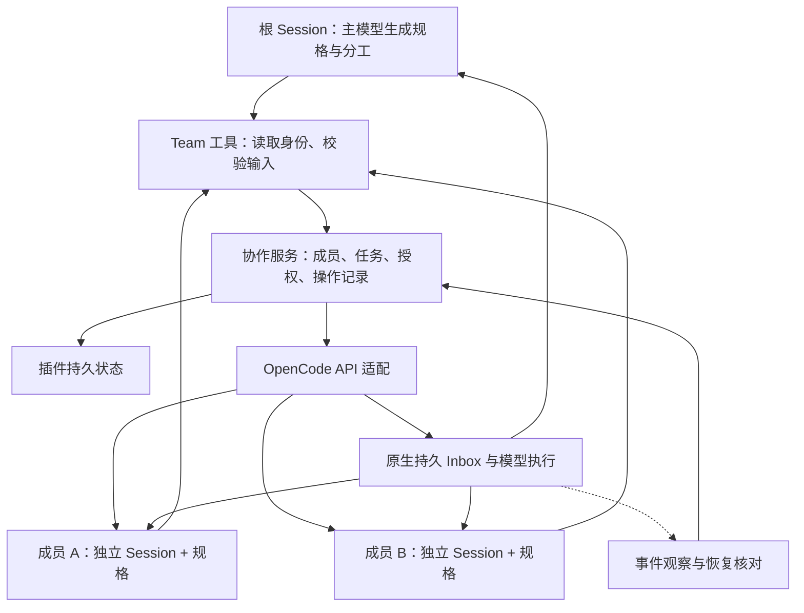

# opencode-agentteam：项目调研与实施计划

文档日期：2026-11-06。状态：已完成本地源码基线上的 P0 核心验证，产品实现尚未开始。项目名称为 `opencode-agentteam`，当前尚未发布 npm 包；本文也用“动态 Team 插件”指代。代码与复现入口见 [README](../README.md)，实测摘要见第 13 节。

## 1. 项目决策

**建议独立实现一个范围受控的 OpenCode 协作插件，复用宿主的 Session、持久 Inbox 和模型执行能力，选择性参考社区项目。**

首要要求是：主模型根据当前任务决定是否组队，以及成员的数量、职责、指令和上下文；插件不预先枚举 planner、coder、reviewer 等职业，也不通过职业名称决定任务资格或执行权限。

这个要求涉及数据模型和调度规则。已调查的项目中，功能较完整的实现往往将固定角色写入这些核心规则；允许自由角色的实现，又尚未提供所需的并发和恢复基础。因此整体 fork 的收益有限。已有代码仍可用于学习消息适配、任务依赖校验和状态记录。

项目提供以下能力：

1. 主模型提交结构化成员规格，插件解析为真实可执行配置。
2. 成员使用独立子 Session，可以并行执行并在同 Team 内交流。
3. 共享任务具有独立身份、负责人、依赖、状态和版本。
4. 成员创建、消息投递和任务修改具有可追溯来源及明确的重试规则。
5. 重启后恢复已保存规格和协作状态，并与宿主事实核对。

第一版优先支持一个本地 OpenCode 服务进程中的多个 Team。首版成员由各 Team 的根 Session 创建；任意深度的递归组队后续再扩展。根与成员是管理关系，专业职责仍可自由生成。

本文描述项目的调研依据、架构选择和实施顺序。当前仓库提供 P0 验证代码，后续产品功能按第 9 节推进。

## 2. 调研依据与证据边界

### 2.1 核对基线

| 对象 | 核对提交 | 用途 |
|---|---|---|
| OpenCode | `3ba597f7769e19cc3b5f67e3d6667e7b6318f6a3` | 判断插件 API、Session、Inbox 和执行机制 |
| DeepSeek Harness | `fcc0ad462172522aaf5c93a7b2e01f6b9f0b0159` | 参考共享任务、成员树与通信语义 |

参考资料：

- [OpenCode 源码基线](https://github.com/anomalyco/opencode/tree/3ba597f7769e19cc3b5f67e3d6667e7b6318f6a3)：宿主 API 与运行语义，具体源码入口见第 4 节。
- [DSH Agent Team 文档](https://github.com/deepseek-ai/deepseek-harness/blob/fcc0ad462172522aaf5c93a7b2e01f6b9f0b0159/docs/subsystems/agent-team.md)：共享任务、成员树与通信语义参考。
- [P0 实测结果](p0-results.md)：验证方法、结果、限制与已确定的设计选择。
- [验证证据摘要](../evidence/2026-11-06.json)：测试统计、关键结果与探针代码摘要。

源码阅读和本次 P0 实测支持“核心能力可通过插件实现”的判断。成员指令、并行执行、Inbox 重试、权限覆盖、持久日志和进程重启已验证；产品权限合成、完整客户端连接适配及 npm 打包组合仍待实现或验证。以后开工时先记录新的宿主基线，不能把本地 checkout 的能力当作所有已发布版本都具备的能力。

### 2.2 社区项目取舍

以下结论来自 README、目录结构及关键源码审查，没有安装运行候选插件；不以星标、测试数量或最后推送日期推断可靠性。

| 候选与源码快照 | 与目标的关系 | 可参考内容 | 不整体采用的主要原因 |
|---|---|---|---|
| [DumDuky/opencode-swarm](https://github.com/DumDuky/opencode-swarm/tree/9d4f25ae841f) | 共享任务和成员协作功能最接近 | 任务依赖、认领、成员服务、文件范围协调 | 固定角色深入任务准入、权限、成员创建与提示词 |
| [cytsaiap-xyz/opencode-agent-team](https://github.com/cytsaiap-xyz/opencode-agent-team/tree/ac03958ae7e0) | 自由生成成员规格符合方向 | plan_team / add_agent 的交互与规格表达 | 单份 activeTeam、全局串行委派、通过状态差集发现孩子 |
| [jabr/opencode-team-plugin](https://github.com/jabr/opencode-team-plugin/tree/9641bd3bbe5f) | 通信不要求固定职业 | 原生 Inbox、queue / steer、Session 寻址 | 不包含完整成员生成与任务板；授权范围需改为 Team |
| [aditya0si/OpenCode-Team](https://github.com/aditya0si/OpenCode-Team/tree/8367c02a6df9) | DAG 核心较通用，完整插件有预设工作流 | 依赖调度、追加记录、状态派生 | 完整工作流采用预设角色与拓扑，需分离通用部分 |

DumDuky 的 [board.ts](https://github.com/DumDuky/opencode-swarm/blob/9d4f25ae841f/src/board.ts) 用 `ROLE_CAN_DO` 决定任务认领资格，并拒绝未知角色；[service.ts](https://github.com/DumDuky/opencode-swarm/blob/9d4f25ae841f/src/service.ts) 又根据职业名称控制写入等行为。只把 `Role` 类型改成 `string` 无法完成改造。

cytsaiap 的 [成员工具与执行路径](https://github.com/cytsaiap-xyz/opencode-agent-team/blob/ac03958ae7e0/src/index.ts) 允许自由指令，但执行基础需要重做。jabr 的 [通信实现](https://github.com/jabr/opencode-team-plugin/blob/9641bd3bbe5f/index.ts) 更适合消息层参考。aditya0si 的 [引擎](https://github.com/aditya0si/OpenCode-Team/blob/8367c02a6df9/src/engine.ts) 可用于理解依赖与执行准入。

若需求以后缩小为“现有 Session 之间互相发消息”，优先改 jabr 会更直接。若维持动态成员、共享任务和恢复这一完整目标，则继续独立实现。借用代码时核对对应文件许可并保留必要的版权与许可声明。

## 3. 产品目标与首版边界

### 3.1 代表性使用场景

用户提出“为一项数据库迁移补上回滚能力并检查兼容性”。主模型自行决定生成两个成员：一个实现回滚，另一个检查旧客户端兼容性。成员名称和职责由本次需求产生，插件没有这两个职业的预设分支。

主模型创建任务与依赖，启动两个独立 Session。成员可以直接交换发现，各自显式更新任务。主模型根据任务状态和结果材料汇总。之后用户换成文献调研，仍使用同一套工具生成不同分工，无需新增职业枚举或固定流水线。

简单任务允许不组队。成员数量受资源上限约束，但不要求至少两人，也不要求始终存在规划、编码、审查等全部岗位。

### 3.2 MVP 包含与暂缓事项

| MVP 必须包含 | 后续按需求扩展 |
|---|---|
| 动态 MemberSpec、独立 Session、规格持久化 | 运行中修改成员能力、复杂 preset 模板市场 |
| 根创建成员，同 Team 直接消息 | 递归创建成员、跨 Team / 跨机器协作 |
| 创建、认领、释放、完成、转交任务与依赖检查 | 自动调度器、多模型委员会、固定审批流程 |
| 显式来源、幂等接受、版本冲突、重启核对 | 跨宿主事务、全局恰好一次执行 |
| 结构化查询、错误信息、基本成员数量限制 | 完整 TUI / GUI 任务板、复杂成本优化 |
| 明确写入分工及真实工具权限 | worktree 自动分配、合并与冲突解决 |

任务 ready 或负责人改变不会自动唤醒成员；首版由模型显式发消息驱动。写入范围首先表达工作分工；只有经执行入口验证的权限才能称为限制，范围字段本身不提供文件隔离。

本项目的定位是协作插件。会记录自身业务来源，但不以 OTel GenAI SemConv 映射为前提。

## 4. 架构与宿主能力映射



| 能力 | 宿主已提供 | 插件负责 | 源码入口 |
|---|---|---|---|
| 创建成员 | `session.create` 的 parentID、id、model、permissions、metadata | 成员登记、规格安装顺序、创建重试 | [Session 协议](https://github.com/anomalyco/opencode/blob/3ba597f7769e19cc3b5f67e3d6667e7b6318f6a3/packages/protocol/src/groups/session.ts) |
| 成员专属指令 | 持久 instruction entry；context hook | 版本固定、启动前安装、恢复一致性 | [指令 entry](https://github.com/anomalyco/opencode/blob/3ba597f7769e19cc3b5f67e3d6667e7b6318f6a3/packages/schema/src/instruction-entry.ts)、[Session 插件接口](https://github.com/anomalyco/opencode/blob/3ba597f7769e19cc3b5f67e3d6667e7b6318f6a3/packages/plugin/src/promise/session.ts) |
| 模型执行与并行 | 不同 Session 的执行协调、上下文处理、中断 | Team 业务关系和状态协调 | [Session 核心](https://github.com/anomalyco/opencode/blob/3ba597f7769e19cc3b5f67e3d6667e7b6318f6a3/packages/core/src/session.ts)、[宿主行为约定](https://github.com/anomalyco/opencode/blob/3ba597f7769e19cc3b5f67e3d6667e7b6318f6a3/AGENTS.md) |
| 成员通信 | prompt / synthetic、queue / steer、resume | Team 授权、来源 metadata、操作记录 | [Session 协议](https://github.com/anomalyco/opencode/blob/3ba597f7769e19cc3b5f67e3d6667e7b6318f6a3/packages/protocol/src/groups/session.ts) |
| 输入接受与交付事实 | enqueued / delivered / cancelled 持久事件 | 与插件 messageId / operationId 关联 | [Session 事件](https://github.com/anomalyco/opencode/blob/3ba597f7769e19cc3b5f67e3d6667e7b6318f6a3/packages/schema/src/session-event.ts) |
| 工具调用身份 | sessionID、messageID、工具调用 id | 从上下文提取 actor 和 origin | [工具接口](https://github.com/anomalyco/opencode/blob/3ba597f7769e19cc3b5f67e3d6667e7b6318f6a3/packages/plugin/src/promise/tool.ts) |
| 业务存储 | get / set / remove / scan，无 CAS | 首版用插件自有 SQLite 事务保存任务、操作与通知 | [Storage 接口](https://github.com/anomalyco/opencode/blob/3ba597f7769e19cc3b5f67e3d6667e7b6318f6a3/packages/plugin/src/promise/storage.ts)、[P0 存储实验](../sqlite-probe.ts) |
| 动态 Agent 定义 | transform 与 reload | 如采用该路径，负责命名和注册恢复 | [Agent 接口](https://github.com/anomalyco/opencode/blob/3ba597f7769e19cc3b5f67e3d6667e7b6318f6a3/packages/plugin/src/promise/agent.ts)、[核心实现](https://github.com/anomalyco/opencode/blob/3ba597f7769e19cc3b5f67e3d6667e7b6318f6a3/packages/core/src/agent.ts) |

优先方案是“一个基础 worker + 每 Session 的专属规格”，避免并发 Team 修改同一个全局 reviewer 定义。能力请求解析成实际 Session 权限和模型选择，不能只写进提示词。

`session.create + prompt` 不自动建立原生 `SubagentJob` 的全部通知关系。插件必须登记成员、观察状态并产生自己的结果通知；模型循环和 Inbox 仍由宿主执行。原生 [subagent 工具](https://github.com/anomalyco/opencode/blob/3ba597f7769e19cc3b5f67e3d6667e7b6318f6a3/packages/core/src/tool/plugin/subagent.ts) 的直接孩子续跑规则，也不等同于插件 Session 投递 API 的授权规则。

公共插件 API 当前没有任意发布自定义持久 Session 事件的通用入口。Team 事实保存在插件数据中，与宿主记录按 ID 关联；不承诺两个存储系统能够原子提交。

P0 确认：原生 HTTP API 支持 Inbox 查询及带游标的持久日志，但 `ctx.session` 没有直接暴露 inbox、message.get、log；`ctx.event.subscribe` 只订阅实时事件。完整客户端的服务地址和认证适配尚未实现，需要在 P1 开始时明确，不能假设它们存在于 `ctx.app`。

## 5. 核心数据与身份规则

本节字段为建议的插件模型，不是宿主已有 API；实现时由 schema 定义最终契约。

### 5.1 MemberSpec

```json
{
  "name": "rollback-analysis",
  "purpose": "分析本次迁移失败后的回滚路径",
  "instructions": "检查部分成功、重复执行和旧数据兼容性，给出具体文件位置与验证材料。",
  "contextFiles": ["docs/migrations.md", "src/migrations"],
  "requestedTools": ["read", "search"],
  "requestedWriteScopes": [],
  "skills": [],
  "modelPreference": "inherit"
}
```

工具名称是设计示例，必须按宿主实际注册资源解析。`inherit` 是建议的插件策略，不是宿主模型 ID。不能将测试、审查等自然语言标签直接解释为受限 shell 权限。

保存两份对应信息：模型提交的请求规格，以及实际解析出的配置快照。快照包括 specVersion、基础 Agent、实际 model、权限规则、指令、已解析上下文来源。成员名称在同 Team 内唯一，只用于展示和寻址；稳定 memberId 决定身份。

首版创建后固定规格，后续工作通过消息交付。新专业分工可以创建新成员；暂不实现运行中的权限升级和全局 Agent 改写。恢复时加载已保存规格，不能让主模型重新生成一份近似指令。模型或资源已不可用时返回明确的不可恢复原因，不静默换配置。

### 5.2 建议实体

| 实体 | 最小字段 | 约束 |
|---|---|---|
| Team | teamId、rootSessionId、location、status、revision、schemaVersion | 初版一个根 Session 对应一个 Team，关闭不删除历史 |
| Member | memberId、teamId、sessionId、creatorSessionId、name、specVersion、resolvedSpec、lifecycle | 名称不是权限；生命周期与当前执行状态分开 |
| Task | taskId、revision、title、description、status、ownerMemberId、dependsOn、acceptance、writeScopes、result | 不绑定职业，任务可持续存在和转交 |
| Message | messageId、operationId、senderMemberId、targetMemberId、taskId、origin、inboxId、deliveryFacts | 接受、交付、取消分别记录；未知不能填成功 |
| Operation | operationId、kind、actor、requestDigest、phase、hostIds、result、error | 支持查询未决操作，重复请求不重复变更 |

`origin` 至少包括来源 sessionId、messageId、callId。来源从工具执行上下文读取，不接受模型传入的 sender 或 actor 作为身份凭证。后台恢复操作记录其原始 operationId；宿主事件引起的观察记录保留事件来源，不伪造工具调用 ID。

Session metadata 可保存 teamId / memberId / specVersion 方便发现，但不是独立授权凭证。宿主可能继承父 Session metadata，因此创建时明确写入孩子身份，并核对插件登记、宿主位置及父子关系。普通 Session fork 不自动加入 Team。

### 5.3 权限与资源

根可以创建、关闭 Team、创建成员、转交任务和中断其成员。同 Team 有效成员可以读取任务、创建任务、尝试认领可执行任务、修改自己负责的任务和向同组成员发消息。根可管理任意本组任务，所有操作仍检查版本。

首版禁止成员仅凭已知 Session ID 联系外部会话；根也只能通过 Team 工具管理已登记的本组成员。成员移除或 Team 关闭后，旧调用不再具有写权限。读取历史的权限另按根身份判断。

成员请求的权限必须受根与用户配置的允许范围约束。宿主 Session 权限的继承与规则顺序需要实际核对；不能把两份规则数组简单拼接就称为权限交集。第一版记录支持的权限形式，无法正确合成时返回明确错误。

资源配置先提供 maxMembers、规格及消息大小上限。成员创建由代码执行数量检查。仅限制成员数量不等于严格限制同时执行数；token 预算、全局并发调度和强制成本上限不在首版保证范围内。

## 6. 任务、消息与工具契约

### 6.1 任务状态

建议持久状态为 `pending → in_progress → completed`，另有 `cancelled`。`blocked` 从未完成依赖派生，不维护另一份可能漂移的状态。

| 动作 | 前置条件与结果 |
|---|---|
| create | 全部依赖存在、属于同 Team、无环；生成 revision = 1 |
| claim | pending、依赖全部 completed、未被其他成员预留；成功设负责人并递增版本 |
| release | 负责人或根执行；回到 pending，清除负责人 |
| reassign | 根执行；回到 pending 并预留给目标成员，目标仍需显式认领 |
| complete | 负责人或根执行；当前 in_progress，提交结果与验收材料引用 |
| cancel | 负责人或根执行；终结任务，下游依赖保持未满足，需根明确调整计划 |

所有既有任务的修改都要求 expectedRevision，包括更新依赖。首版仅允许在 pending 时改变依赖，避免运行中修改计划却没有对应执行处理。依赖图验证与任务提交在同一个 Team 串行区间内完成。

转交任务不会停止旧执行者，取消任务也不等于中断 Session。根需另行中断并核实运行事实，避免两人同时继续写。旧执行者的完成请求因负责人或版本不符被拒绝，但这本身不能撤销其文件改动。

`complete` 表示授权成员提交了完成声明与材料，代码校验身份、状态和数据；不自动证明业务验收正确。主模型据材料决定是否接受整体结果，必要的独立审查可建为另一个任务，不固定成每次必经阶段。

### 6.2 建议工具面

工具名称暂定，保持清晰且数量有限。读取接口用显式 view 区分数据；变更接口用 schema 描述每种 action 的必填字段。

| 工具 | 用途 | 关键返回 |
|---|---|---|
| team_open | 根启用或重新取得当前 Team | teamId、配置、已有成员 |
| team_spawn | 提交 MemberSpec 并创建孩子 | memberId、sessionId、specVersion、operationId、阶段 |
| team_read | 查询成员、任务、消息、操作或 Team 概况 | 稳定 ID、revision、宿主观察时间、未决原因 |
| team_task_create | 新建独立任务 | taskId、revision |
| team_task_update | claim / release / reassign / complete / cancel / edit | 新版本或结构化冲突 |
| team_send | 向本组成员或根投递工作和消息 | operationId、messageId、inboxId、accepted |
| team_interrupt | 根中断成员当前执行 | 宿主是否实际中断；任务状态保持原值 |
| team_close | 根关闭 Team，保留历史 | 关闭进度、仍在执行的成员及未决操作 |

初版不提供容易产生误解的 `wait until task done`：先通过查询和结果通知完成闭环。若后续增加等待工具，需明确等待的是新输入、宿主空闲还是业务任务完成。

任务和消息变更都应接受可复用 requestId，或由工具调用上下文生成默认操作键。同一次工具调用重试复用原操作键；模型发起新的工具调用重试时，应显式携带上次返回的 requestId，插件不按文本相似度猜测重复。

相同操作键且相同请求返回原结果；相同键配不同有效载荷返回冲突。返回缓存结果前仍校验调用身份。工具应返回明确的 revision_conflict、dependency_unmet、not_member、permission_denied、operation_pending 等错误类别和可恢复信息，不只给一段报错文本。

### 6.3 消息状态与来源

成员普通通信默认采用 queue；显式 steering 请求才使用 steer。具体唤醒策略通过参数表达，接受与执行分离。调用者收到 accepted，只能解释为宿主接受了输入。

必须区分以下事实：

1. 插件保存发送意图。
2. 宿主以固定 inboxId 接受输入。
3. 宿主将该输入交付到模型可见上下文。
4. 接收方通过工具或回复显式报告处理结果。
5. 对应工作项由授权者完成。

原生 `session.execution.*` 事件的载荷以 Session 为单位，不能假定带有逐条请求的 executionId / inputId。一次执行可能消费多条输入，某条输入也可能涉及多个步骤。不能用“这个 Session 刚空闲”推导“m42 已处理”或“task-3 已完成”。

消息可带 replyToMessageId 表达显式回复；任务操作直接带 taskId。执行结束通知可以报告已核实的 Session 事实，业务完成通知应来自显式任务提交。断线后无法证明的处理状态保留为 unknown，不能仅按时间接近拼接因果。

目标 Inbox metadata 保存 teamId、senderMemberId、senderSessionId、originMessageId、originCallId、taskId、operationId、messageId。于是“工具调用 call-123 发送的 m42”有确切记录；“B 完成了 m42 对应工作”仍需接收方结果或任务提交支持。

## 7. 持久化、提交和恢复

### 7.1 MVP 存储选择

**根据 P0 实测，首版在已验证的 Bun 环境中采用插件自有 SQLite。** 在同一事务内校验任务 revision 与依赖、提交状态修改、记录操作结果和待发送通知；等待事务成功后再返回已提交。事务中不等待宿主 API 或模型执行。

`ctx.storage` 按插件 ID 共享于多个 Location 实例，公开接口没有 CAS 或多键事务。实验中两个实例能访问同一个键，并发先读 0 再写 1 得到 1。底层单条 SQL 写入及已提交数据可恢复，不意味着上层读改写具有条件提交语义；单个实例的内存锁也不能保护其他实例。

插件可通过公共加载路径使用 `bun:sqlite`。两个真实进程竞争相同 expected revision 只有一个成功，任务与 outbox 可一起回滚或提交并重新读取。该结论只证明存储原语可用，完整事务模型、数据迁移和恢复协议仍需实现。首版仍不支持多个 OpenCode 服务进程共同管理一个 Team 的执行所有权。

`ctx.storage` 可保留简单配置和索引用途。消息正文尽量依赖原生 Inbox / 历史，插件事务库只保留未决发送所需载荷及必要索引。定义记录容量、终结操作保留期限和可重试期限，避免无限增长。宿主与插件数据库之间的提交仍靠准备记录、固定 ID 和恢复核对衔接。

### 7.2 创建成员的恢复流程

1. 校验 actor、资源上限与规格，预分配 memberId / sessionId / operationId；持久化创建意图。
2. 使用固定 sessionId 创建孩子；重试遇到已存在 Session 时，核对 parent、Location 和插件登记，不直接接管任意同 ID 会话。
3. 安装已保存版本的指令及真实配置，确认就绪后才启动首条输入。
4. 使用固定输入 ID 投递初始工作，记录接受结果；部分失败保留操作阶段，供查询和恢复。

宿主重用 Session ID 会采用已有 Session，不等于重新应用本次创建参数。恢复必须读取并核对已有配置；配置不符或无法确认归属时停止该操作并给出原因。

### 7.3 消息与任务通知的恢复流程

发送前保存意图与固定输入 ID，再调用宿主接受接口，最后保存接受结果。宿主已经接受而插件尚未记录就退出时，恢复使用同一输入 ID 重试或核对。宿主的首次接受载荷生效，因此不同内容不可沿用原 ID。

任务完成与“通知根”的发送意图应在同一插件提交中保存；通知走上述投递流程。这样任务提交成功后即使进程退出，也能继续通知。通知迟到不改变已提交任务事实。

提供 operation 查询入口，显示 prepared / pending / accepted / failed 等明确阶段和下一步处理方式。恢复过程可以多次执行，但不会凭空重复创建成员或执行任务状态变更。

### 7.4 重启与事件订阅

启动时先恢复登记和未决操作，再与宿主 Session、Inbox / 已交付消息和当前执行状态核对；同步恢复期间的事件变化。P0 已验证 HTTP 持久日志的 after 游标和 log.synced 水位。若接入完整客户端，可按水位回放后续读；仅使用插件上下文时，需先订阅并缓存、核对可查事实，对无法还原的历史保持 unknown。具体连接适配在 P1 落实，不能把实时订阅当作事件回放。

不通过不断轮询“是否 idle”推断业务完成。不能查明的消息处理结果保留 unknown；成员失联不自动释放任务，根可在核实后转交。宿主执行恢复由宿主负责，插件不会因发现一个旧任务就无条件重投初始指令。

Team 关闭采用 closing → closed：先禁止新成员与新的工作投递，再按策略中断成员、核对未决操作并保留未完成任务。关闭工具应返回实际进度，不能仅设置一个标志就宣称全部执行已经停止。

## 8. 代码组织与实现方式

使用 TypeScript，优先采用当前 OpenCode 公共 Promise 插件 API。包名、发布导出、支持的运行时在 P0 确认；本地源码中的版本号不作为 npm 包已可用的证明。避免直接导入宿主 Core 私有实现。

建议初始布局，按实际复杂度调整，不预建大量空抽象：

```text
<repo>/
  README.md
  package.json
  src/
    index.ts                 # 插件注册、实例生命周期
    tools.ts                 # 工具 schema、结果呈现、上下文身份
    model.ts                 # 业务 schema 与状态类型
    members.ts               # 规格解析、创建、成员授权
    tasks.ts                 # 状态转换、依赖、版本检查
    messages.ts              # 投递、来源、通知
    store.ts                 # 提交边界、版本、操作记录
    recovery.ts              # 未决操作与宿主状态核对
    opencode.ts              # 公共 API 适配，集中实验接口
  tests/
    domain/                  # 状态、权限、依赖与并发提交
    integration/             # 真实宿主契约、重启和故障窗口
  docs/
    design.md
    compatibility.md
    recovery.md
```

业务层依赖明确的宿主适配接口，不散落 SDK 调用。测试替身用于重复、迟到、超时等故障控制，真实宿主集成测试验证 SDK 行为，避免仅用 mock 证明自身假设。

先暴露结构化工具和简洁查询输出。任务板 UI 可以在协议稳定后添加，不作为核心闭环的前置工作。

## 9. 分阶段实施计划

P0 的本地源码核心验证已通过，P1–P4 尚未开始。公开发布包兼容性和完整客户端连接适配仍有明确待办。各阶段以可验证产物为出口，不预估缺乏依据的工期。

### P0：验证宿主契约，确定可用基线

已交付：[最小插件与复现入口](../README.md)、[基线及结果](p0-results.md)、确定的成员指令和 SQLite 存储方案。

- [x] 从源码公共包导出加载本地插件，验证工具注册和 Session API；npm 发布组合尚未验证。
- [x] 两个子 Session 携带不同规格同时进入模型请求，指令互不串用。
- [x] 持久 instruction entry 在首次执行、成功压缩及进程重启后仍生效。
- [x] 固定 Session ID 采用原对象；固定输入 ID 在接受前后重试均保留首次载荷。
- [x] Inbox 接受与交付、实时事件、HTTP 持久日志及游标得到验证；插件内完整客户端连接适配待做。
- [x] 实际工具调用上下文身份写入兄弟 Inbox；权限继承与显式替换得到验证。
- [x] 复现 KV 共享作用域与丢更新；验证 SQLite 条件更新、事务回滚与持久提交，选择事务数据库。

出口：形成可重复运行的最小实验与结论。若指令路径不满足要求，可评估 context hook 或成员独立 Agent 定义；没有等价保证时明确记录限制，不静默降级。必要能力缺失则先收缩兼容范围或提出具体宿主扩展，不进入大规模业务实现。

### P1：动态成员与通信闭环

依赖：P0。产物：可安装的开发版，能按任意合法职责创建成员并直接通信。

- [ ] Team / MemberSpec / Operation schema、根身份、资源上限和规格解析。
- [ ] 明确完整公共客户端的地址与认证来源，或限定首版仅使用 `ctx.session` 可查询的事实；不虚构历史处理状态。
- [ ] team_open、team_spawn、team_read、team_send 的最小实现。
- [ ] 创建意图、固定 ID、配置就绪后启动、消息来源和接受结果。
- [ ] 两个 Team 并存且同名成员不串配置；成员之间可以通信。

出口：不在代码中增加职业枚举即可完成两种不同领域任务的分工。通过确定的 API 返回值登记成员，不用 Session 列表差集猜测孩子身份。创建与发送失败可查询和恢复。

### P2：共享任务与业务完成

依赖：P1。产物：可运行的任务板服务及模型可用的协作指引。

- [ ] taskId、revision、负责人、依赖、验收说明与状态转换。
- [ ] 创建、认领、释放、转交、完成、取消及 pending 任务编辑。
- [ ] 循环依赖、跨 Team 引用、并发认领和陈旧版本校验。
- [ ] 完成提交与通知意图同次持久化；任务身份关联消息。
- [ ] 根汇总材料，任务完成与 Session idle / execution succeeded 明确分离。

出口：两个成员竞争同一任务只有一个成功；根可转交原 taskId；依赖解除后由明确消息推进工作；任意 Session 结束都不会误标任务完成。

### P3：恢复、关闭与 MVP 验收

依赖：P2。产物：可用于日常本地任务的 MVP、恢复说明和故障测试记录。

- [ ] 启动时恢复成员规格、未决创建、发送和任务通知。
- [ ] 事件中断与重复、进程退出、宿主已接受但插件未确认等窗口测试。
- [ ] team_interrupt、team_close 与仍在运行成员的显式状态处理。
- [ ] 状态 schemaVersion、容量及操作保留策略、明确的错误恢复说明。
- [ ] 完成第 10 节的必要场景，记录实际测试命令与宿主版本。

出口：重复重启和重试不会重复产生协作对象；持久化失败不返回提交成功；无法核实的状态有明确显示；关闭不丢失已保存任务和来源。

### P4：实际使用与发布准备

依赖：P3。产物：使用案例、明确兼容范围、安装卸载说明及首个候选版本。

- [ ] 用代码修改、只读调查两类任务验证动态分工，不只运行预设职业演示。
- [ ] 检查主模型能否发现冲突、理解错误、避免重复发送，并自主决定何时不组队。
- [ ] 与原生子任务或已有编排插件做相同任务对照，记录结果、人工介入、耗时和成本；宿主数据不支持准确归因的项目标明不可比。
- [ ] 整理兼容性、默认权限、数据位置、关闭与恢复操作，以及借用代码的许可。

发布前需要固定并验证可安装的版本组合，提供安装、升级与卸载说明。是否增加 GUI、worktree、递归成员及自动调度，由真实使用问题决定。

## 10. 必要验收场景

| 场景 | 必须观察到的结果 | 层次 |
|---|---|---|
| 自由职责 | 新增任意合法职责不需要修改角色枚举或授权分支 | 领域 + 实际使用 |
| 专属规格隔离 | 同名成员分属两个 Team，指令与模型配置互不覆盖 | 宿主集成 |
| 身份与权限 | 伪造 sender、借用外部 Session ID、越权能力请求不能取得权限 | 领域 + 宿主集成 |
| 并发认领 | 相同 revision 的两个 claim 最多一个成功，另一方得到最新版本信息 | 存储集成 |
| 依赖约束 | 自环、环、跨 Team 依赖被拒；依赖未完成不能认领 | 领域 |
| 任务转交 | taskId 保留；旧负责人或旧 revision 无法提交完成；旧运行需单独处理中断 | 领域 + 集成 |
| 创建重试 | 宿主创建后插件退出，恢复采用正确的原孩子；错误归属不得接管 | 故障集成 |
| 消息重试 | 宿主接受后插件退出，重试不重复接受同一输入；变更载荷复用键报冲突 | 故障集成 |
| 交付语义 | accepted、delivered、显式回复与任务完成可以分别呈现 | 宿主集成 |
| 迟到或丢失事件 | 不将旧 execution 事件归因于新工作，不以空闲替代完成 | 故障集成 |
| 任务提交后退出 | 任务仍保持完成；未发送通知可恢复，任务变更不重复发生 | 故障集成 |
| 写入失败 | 不返回成功，不发送依赖于未提交任务状态的通知 | 存储故障 |
| 压缩与重启 | 已保存成员规格和来源关联可恢复，不重新生成职责 | 宿主集成 |
| 关闭与移除 | 禁止新工作，报告残余执行及未决操作，历史任务仍可由根查询 | 集成 |

实现时记录测试命令、宿主 commit、通过范围和限制。领域规则优先用确定性测试；真实宿主测试验证接口和恢复；模型行为通过代表性场景评估，不将一次成功对话视为完整可靠性证明。

## 11. 待验证事项与停止扩张条件

| 问题 | 默认方案 | 需要调整方案的证据 |
|---|---|---|
| 持久 instruction entry 是否满足首次执行与恢复 | 基础 worker + 单 Session 规格 | P0 无法证明指令正确生效，改评估 context hook 或独立 Agent |
| 多实例如何保护业务提交 | P0 后选择插件自有 SQLite 条件更新及事务 | 若拓展多服务进程执行，仍需另行解决执行所有权 |
| 消息与执行能否精确关联 | 原生输入 ID + 显式 reply / task 操作 | 宿主缺少事实时保留 unknown，不增加时间猜测算法 |
| 是否需要完整动态 Agent 注册 | 首版不需要 | 实际能力无法用 Session 专属配置表达时再评估 |
| 是否需要自动调度与递归创建 | 模型显式派工，根创建成员 | 日常任务出现可复现的协调瓶颈后再扩展 |
| 是否需要 fork OpenCode | 核心协作使用公共插件 API | 只有明确需要宿主级事务或无法替代的原生能力时才讨论 |

当兼容宿主、持久化或授权前提未成立时，先解决该前提，不靠追加提示词掩盖。若实际使用中动态分工并未改善结果或降低协调成本，也应允许缩小项目为可复用通信与任务组件。

## 12. 以后开始开发时的入口

建议按以下顺序恢复上下文：

1. 阅读本文第 1、3、9 节，确认目标仍是自由生成职责的协作插件。
2. 记录当时 OpenCode commit / 可安装包版本，阅读其适用开发约定；对照第 4 节 API 路径重新核实。
3. 在当前仓库继续开发并维护本文；P0 代码和验证证据已纳入 Git，可按 README 从公开宿主基线重建实验环境。
4. 按 P0 仓库 README 在当时基线上复现关键检查，确认接口没有变化。
5. 沿用已验证的专属指令和 SQLite 方案，明确公共客户端连接方式，再按 P1 → P2 → P3 推进。

可直接用于后续开发会话的任务说明：

> 根据《opencode-agentteam：项目调研与实施计划》及 P0 实测结果开始后续开发。核心要求是主模型按任务生成成员规格，不固定枚举专业角色，也不按角色名称控制权限。先在当前宿主基线上复现已有 P0，核实完整客户端连接方式，再实现 P1 的 MemberSpec、成员登记、Team 授权和原生 Inbox 投递。使用 Git 维护代码；任务存储采用插件自有 SQLite，后续按 P2 / P3 完成任务与恢复。本阶段不建设 GUI 或自动调度器，也不发布插件。

## 13. P0 验证结果补充（2026-11-06）

**13 项公共插件集成检查、142 项选定宿主测试和 3 项 SQLite 检查通过。** 测试基于本地 OpenCode 固定提交与 Linux x64 / Bun 1.4.2；源码声明的 Bun 1.4.4 尚未重跑。真实 Session、工具、数据库和压缩流程使用宿主实现，外部 LLM 使用可控本地响应替代，没有调用真实模型评估协作质量。

| 结论 | 证据与边界 |
|---|---|
| 动态成员配置可行 | 两个模型请求同时等待显式放行，各自只含自己的持久指令；成功压缩和进程重启后仍生效 |
| 原生接受可幂等重试 | 首次内容、metadata、delivery 保留；已交付后重试不新增 Inbox 项；跨 Session / 类型复用 ID 冲突 |
| 来源调用可可靠关联 | 模型实际调用工具，工具上下文三项身份写入兄弟 Inbox，重启后仍在 |
| 权限必须由插件收敛 | 父 deny 可被孩子显式 allow 替换；不能直接授予模型要求的全部权限 |
| KV 不能直接承担 CAS | 不同 Location 的实例共享同插件 ID 的键，读改写竞争发生丢更新；因此选择自有 SQLite |
| 事务存储原语可用 | SQLite 两进程版本竞争仅一方成功，任务和通知可以同次提交或回滚 |
| 事件不等于任务完成 | execution started / succeeded 的 data 只有 sessionID；实时订阅不回放；HTTP 日志另提供 after / log.synced |
| 基础数据可恢复 | 对已接受数据执行 SIGKILL，再启动新宿主，Session、指令、未交付消息、KV 与插件数据库数据保留 |

代码、实施计划和验证摘要由本仓库维护。原始日志、JUnit、临时依赖与数据库被 Git 忽略。完整复现方式见 [README](../README.md)，详细结果和限制见 [P0 报告](p0-results.md)，可追溯摘要见 [验证证据](../evidence/2026-11-06.json)。

这些结果允许进入 P1，但还不构成产品完成：npm 发布组合、完整客户端连接认证、权限合成、热重载交接、完整未决操作恢复及真实模型分工效果仍未验证或实现。SQLite 并发提交也不等于宿主支持跨进程执行，更不等于宿主与插件数据库拥有跨库事务。
